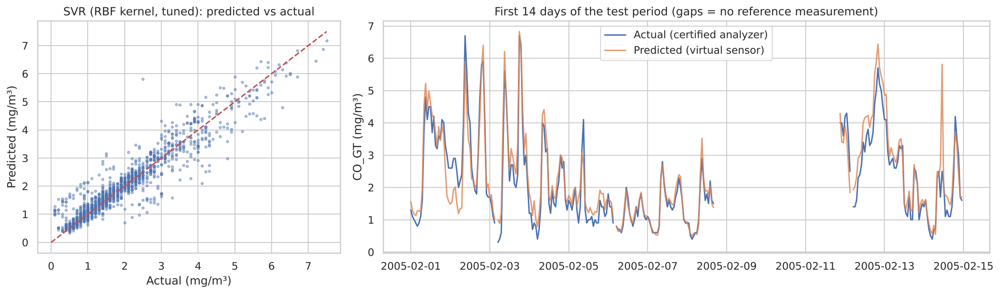

# Air quality virtual sensor

Predicting certified carbon monoxide (CO) concentrations from a low-cost multisensor device, with time-series validation and explainable AI.

## The question

Certified air-quality analyzers are accurate but expensive, so cities can only afford a few of them. Low-cost metal-oxide sensors could fill the gaps, but they react to more than one gas and drift over time. **Can a model turn the readings of cheap sensors into a reliable CO measurement (a "virtual sensor"), and how long does such a calibration stay valid?**

## Data

- **Source:** [UCI Machine Learning Repository: Air Quality](https://archive.ics.uci.edu/dataset/360/air+quality). 9,357 hourly records (March 2004 – April 2005) from a device with 5 metal-oxide sensors plus temperature and humidity, placed at road level in an Italian city, together with reference concentrations from a co-located certified analyzer.
- **Not included in this repository.** The notebook downloads it automatically.
- **Citation:** S. De Vito, E. Massera, M. Piga, L. Martinotto, G. Di Francia, "On field calibration of an electronic nose for benzene estimation in an urban pollution monitoring scenario", *Sensors and Actuators B: Chemical*, 129(2), 750–757, 2008.

## Method

1. **Data cleaning:** missing-value codes, 366 hours of device failure removed, short gaps (≤ 3 h) interpolated for the exploratory analysis only, outliers analysed and kept as real pollution episodes.
2. **Exploratory analysis:** daily and weekly traffic patterns, seasonality, how well each cheap sensor tracks the reference, interactive Plotly views.
3. **Modelling:** chronological train/test split (test period February – April 2005); every choice made with time-series cross-validation on the training period only; 8 model families against two baselines (training mean and single-sensor calibration), tuned with grid search.
4. **Explainability:** SHAP (model-agnostic permutation explainer for the selected SVR, cross-checked with XGBoost's exact TreeExplainer).
5. **Further analyses:** leakage test (random vs chronological split), residual diagnostics, outlier sensitivity, a recalibration simulation and a drop-one-feature test.

## Results

| | Single-sensor calibration | **Selected model: SVR (RBF kernel)** |
|---|---|---|
| MAE on the future test period | 0.56 mg/m³ | **0.28 mg/m³** (50% lower) |
| R² | 0.685 | **0.889** |

- **The key input is not the CO sensor.** The hydrocarbon sensor S2 drives the predictions: removing it drops R² from 0.889 to 0.817, while the dedicated CO sensor is nearly redundant once S2 is present. SHAP and a drop-one-feature test agree, for two different model families.
- **Honest validation matters.** A random split would overstate performance (R² 0.927 instead of 0.874 for XGBoost), and a frozen calibration degrades from about 11% to 14–19% relative error over the following months.

## My contribution

Team of 3 (Pablo Reche, Ignacio Argüelles and me) for the *Data Analysis & Visualisation* course at Université Toulouse Capitole (Erasmus exchange, 2026).

The first version of the pipeline was built as a team. I was the project's technical reviewer and led its second iteration, which turned a working coursework notebook into a methodologically sound analysis:

- **Methodology audit:** found and fixed problems that inflated or invalidated results, such as model selection on the test set (moved to time-series cross-validation), missing baselines, mislabelled units, a gap-interpolation bug (pandas' `limit` silently filled long gaps) and claims the data did not support.
- **SVR, end to end:** implemented and tuned the support vector regressor that became the final model, its model-agnostic SHAP explanation, and the comparison with XGBoost.
- **New analyses:** residual diagnostics, outlier sensitivity, a recalibration simulation, a drop-one-feature test and an interactive monthly profile, each answering a question the first version left open.

## How to run

- **Colab:** click the badge above; the data downloads automatically. A full run takes about 6 minutes.
- **Locally:** `pip install -r requirements.txt`, then open `air_quality_virtual_sensor.ipynb` in Jupyter or VS Code.

Interactive Plotly charts do not render in GitHub's preview; open the notebook in Colab to see them.